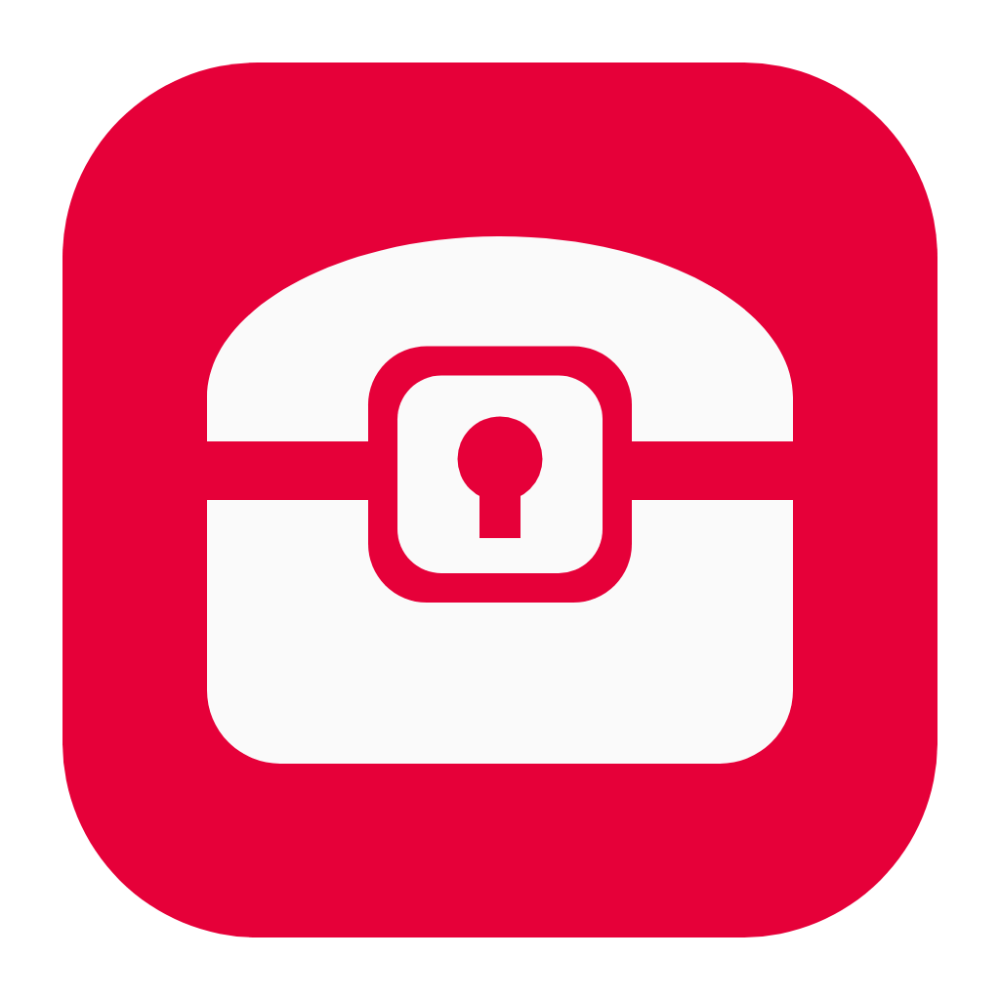
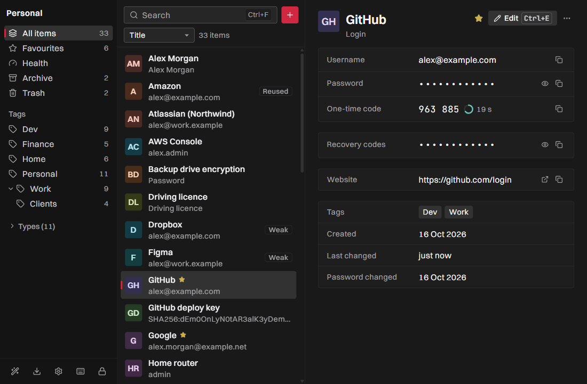
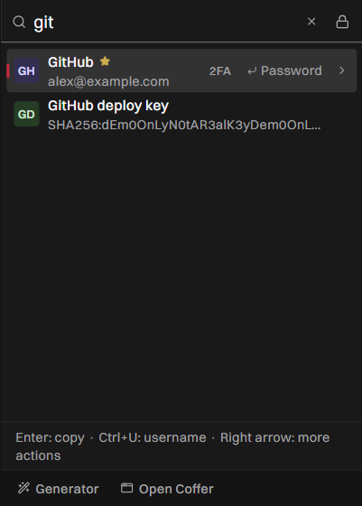
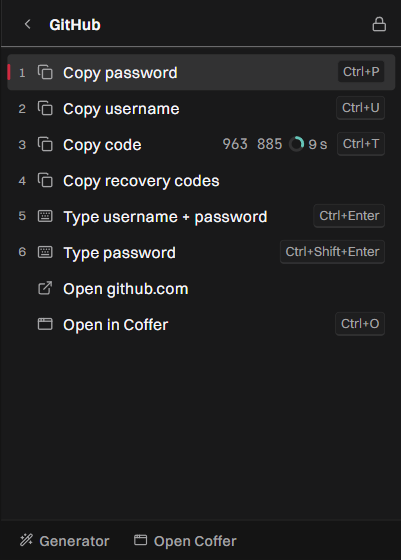
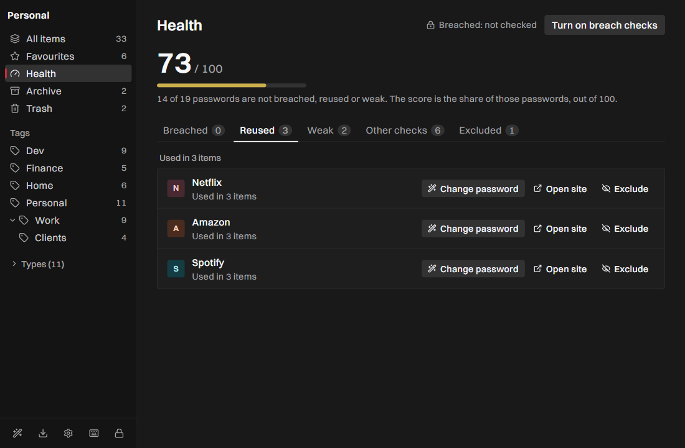
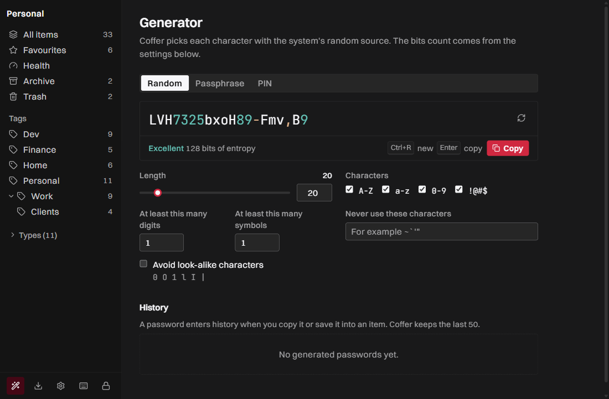
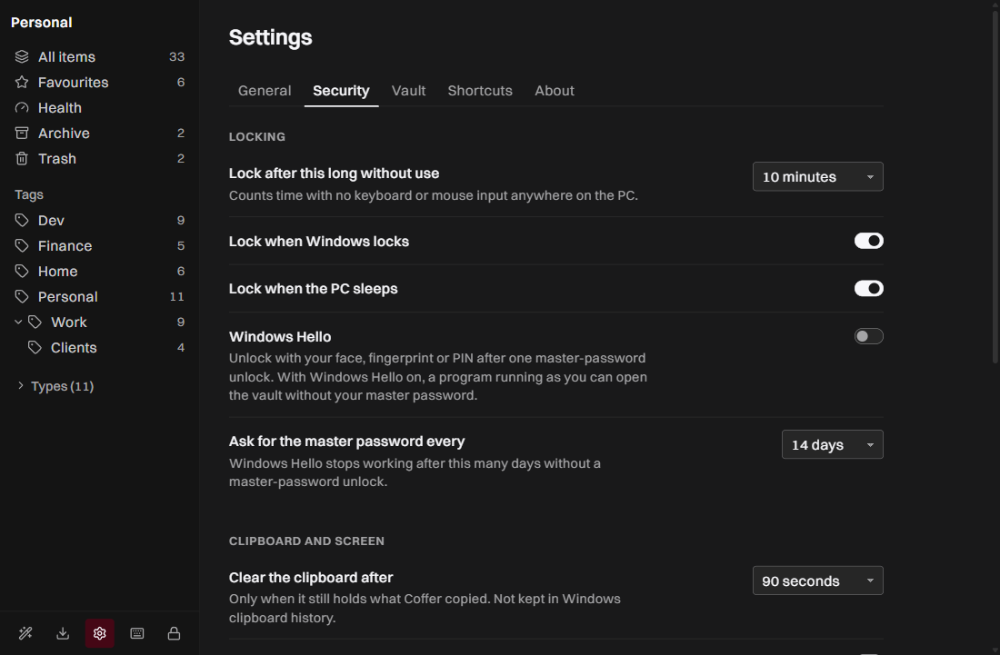

<p align="center">
  
</p>

<h1 align="center">Coffer</h1>
<p align="center">A local-first password manager that lives in the Windows tray.</p>

<p align="center">
  <a href="https://github.com/011-sam-110/coffer/releases"></a>
  
  
  
  
  
</p>

<p align="center">
  
</p>

Coffer keeps your passwords in one encrypted file on your own disk. It has no account, no server and no subscription. You open it from the tray (under the "^" arrow next to the clock, like a VPN app) or with Ctrl+Shift+Space from any app. The feature set takes what works without a server from 1Password, Bitwarden and Dashlane. The research, the spec and its five review rounds are in [`docs/`](docs/).

_Status: v0.1.0 pre-release for Windows 10 and 11. The installer is not code-signed, and nobody outside this project has audited the crypto. Windows Hello and auto-type are the newest parts and have had the least real-world use._

## ✨ Features
- **Two-secret unlock** - a master password plus a 128-bit Secret Key, through Argon2id (128 MiB, 3 passes) with stored parameters, a floor and a ceiling. You get an Emergency Kit when you create the vault, and Coffer asks you to confirm it before you go on.
- **One encrypted vault file** - XChaCha20-Poly1305 records under a random vault key. Saves are atomic, a generation counter catches an older copy put back in place, and a change from a synced folder becomes a conflict copy, never a silent overwrite.
- **Quick Access** - a 400 x 560 popup from the tray or Ctrl+Shift+Space, with suggestions for the app you came from. Enter on a login fills the sign-in (below); Ctrl+C copies the password, Ctrl+U the username and Ctrl+T the one-time code, without opening the main window.
- **Smart fill** - Enter types into the app you came from what fits the box that has the cursor: the email and password on a one-page sign-in, the email alone on a two-page one, then "Type password" and "Type code" at the next opens. Coffer reads the box with Windows UI Automation, in any browser or app, and never clicks. Ctrl+Shift+Enter types the password alone. Coffer refuses to type into an app that runs as administrator.
- **Windows Hello (optional, off by default)** - after one master-password unlock, face, fingerprint or PIN can unlock again in the same session. The master password is needed again after a restart and after 14 days (you can change the number of days).
- **PIN unlock (optional, off by default)** - a PIN of 6 to 12 digits unlocks Coffer and Quick Access on this PC, also after a restart. 5 wrong PINs remove it, and the master password is needed again after 14 days. The vault file does not change: away from this PC it still needs the master password.
- **Tray app** - close-to-tray, start with Windows, a tray menu, one instance at a time, and a tray icon that shows locked or unlocked.
- **Auto-lock** - after a set idle time, when Windows locks and when the PC sleeps. Secrets stay in the Rust process and reach the window only when you press Reveal.
- **Clipboard care** - copies stay out of Windows clipboard history and cloud clipboard, and are cleared after 90 seconds (you can change this) if the clipboard still holds them.
- **11 item types** - logins, passwords, notes, cards, identities, bank accounts, documents, SSH keys, API credentials, Wi-Fi and licences. Items have typed fields, tags, favourites, an archive, a 30-day trash, password history, revisions you can restore, and a per-item "ask for the master password" switch.
- **Generator** - random, passphrase (EFF word list) and PIN, with a strength meter that shows how it counts, and a generator history.
- **One-time codes** - TOTP from `otpauth://` links, `steam://` and pasted secrets, or from a QR code on screen or in an image file.
- **SSH keys** - Ed25519 key generation in OpenSSH format, stored as an SSH key item.
- **Health** - weak, reused, old and duplicate items, `http://` sites, and cards and documents about to expire. A score shows its formula, each problem has a fix action, and an Excluded tab holds what you chose to ignore. An opt-in breach check uses k-anonymity: only the first 5 hex characters of a SHA-1 hash leave your PC.
- **Import** - 1Password (1PUX, CSV), Bitwarden (JSON, CSV), Dashlane (CSV ZIP), browser CSV files and other Coffer vaults. A preview skips items you already have, and one Undo moves the whole import to the Trash.
- **Export and backups** - export as a Coffer encrypted file, Bitwarden JSON or CSV. Encrypted backups are made automatically, and you can restore one.
- **Secret Key rotation** - a new Secret Key re-encrypts the whole vault and gives you a new Emergency Kit.
- **Screen-capture protection** - the windows are hidden from screenshots and screen sharing (on by default).

## 📸 Screenshots
| Quick Access: search | Quick Access: every action has a key |
|---|---|
|  |  |

| Health | Generator |
|---|---|
|  |  |

| Security settings | |
|---|---|
|  | |

The screenshots come from the installed app with a vault of made-up items.

## 🛠 Stack
Rust (vault core: `argon2`, `chacha20poly1305`, `zeroize`) · Tauri 2 · React 19 · TypeScript · Vite · Tailwind CSS 4 · Windows APIs through the `windows` crate (DPAPI, Windows Hello, clipboard formats, `SendInput`, session and power events, display affinity) · Switzer and JetBrains Mono fonts

## 🚀 Install
1. Download `Coffer_0.1.0_x64-setup.exe` from [Releases](https://github.com/011-sam-110/coffer/releases).
2. Run it. It installs for your Windows user only, so it needs no admin rights. The installer is not code-signed, so Windows SmartScreen may warn first: choose "More info", then "Run anyway".
3. Coffer opens on its Welcome screen. Create a vault, save or print the Emergency Kit, and look for the Coffer icon under the "^" arrow next to the clock. Drag it onto the taskbar to keep it in view.

Your vault is in `%USERPROFILE%\Coffer` unless you choose another folder. The settings, this PC's copy of the Secret Key and the backups are in `%LOCALAPPDATA%\Coffer`. Uninstalling leaves both folders where they are.

**Build from source** (needs Rust stable, Node 20 or later and pnpm):
```bash
pnpm install
pnpm tauri build
```
The installer lands in `target/release/bundle/nsis/`. The build first fetches the Switzer font from Fontshare into `public/fonts/itf/`. The font is not in the repo: its licence (ITF Free Font License) covers using it in the app, not sharing the font files.

`pnpm dev` runs the UI in a browser at `http://localhost:1420` with a demo backend and made-up items, for UI work without the Rust side.

## 🧠 How it works
```
crates/coffer-core   vault file format, crypto, items, import and export, health, generator, TOTP
src-tauri            the Windows app: tray, windows, hotkeys, clipboard, lock signals, Hello, auto-type
src                  the React UI for the main window (index.html) and Quick Access (quick.html)
src/lib/contract.ts  the IPC contract: every command and event between the UI and Rust
docs/SPEC.md         the product and security spec, with its review history
docs/SECURITY.md     the threat model, the key design and the known limits
```
The vault key never leaves the Rust process. The UI asks for an action, such as "copy the password of this item", and Rust puts the value on the clipboard itself. The UI gets a secret only when you press Reveal or edit a secret field. Each window may call only the commands it needs: Quick Access cannot change settings, and only Quick Access can auto-type.

Tests: `cargo test --workspace` runs 146 core tests (including RFC test vectors for Argon2id, HKDF, XChaCha20-Poly1305 and TOTP) and 69 app tests. `pnpm test` runs 156 UI tests. A QA pass drove the release build against the spec, and two rounds of design review fed into the UI.

<p align="center"><sub>Built by <a href="https://github.com/011-sam-110">@011-sam-110</a></sub></p>
